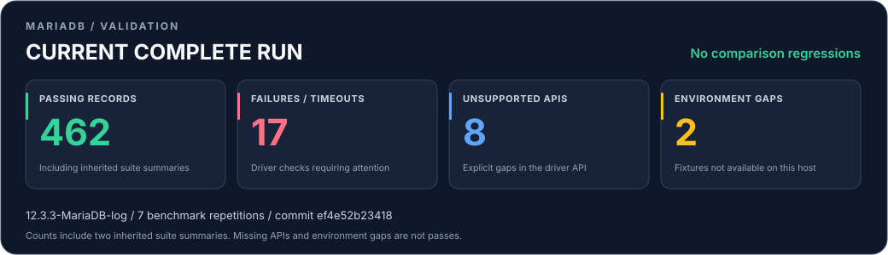

# MariaDB Haskell

A streaming Haskell driver for **MariaDB only**, forked from
[mysql-haskell](https://github.com/winterland1989/mysql-haskell). This fork adds
MariaDB's native statement, session, authentication and replication capabilities,
with bounded decoding and explicit connection ownership. MySQL servers are not
a support target.

**[User guide and examples](https://github.com/aantich/mariadb-haskell/blob/main/docs/USER_GUIDE.md)** ·
**[Live test and benchmark report](https://github.com/aantich/mariadb-haskell/blob/main/validation/RESULTS.md)** ·
**[Benchmark guide](https://github.com/aantich/mariadb-haskell/blob/main/docs/BENCHMARKS.md)** ·
**[Migration guide](https://github.com/aantich/mariadb-haskell/blob/main/docs/MIGRATION.md)**

## Features

| Area | What the driver provides |
| --- | --- |
| Connections | TCP, Unix sockets, verified TLS and client certificates; full Unicode (`utf8mb4`) by default |
| Queries | Streaming list/vector rows, checked text parameters, managed binary prepared statements, multiple results and stored-procedure OUT parameters |
| Native statements | MariaDB binary bulk execution, NULL/DEFAULT/IGNORE indicators, per-unit results, cached and extended column metadata |
| Large data | One-shot streamed byte/text parameters, bounded upload chunks and server cursor fetches |
| Sessions | Public session observations and connection reset with role/schema/charset restoration and an initialization hook for pools |
| Operations | Progress callbacks and opt-in zlib transport compression |
| Authentication | Native password, Unix-socket accounts, ed25519, PARSEC, SHA-2, TLS certificate accounts, explicit PAM dialogs and Kerberos GSSAPI |
| MariaDB values | Signed/unsigned integers, exact decimals, Unicode and bytes, raw zero/partial dates, and wire representations for JSON, UUID, INET, VECTOR and geometry |
| CDC | Row-based binlog decoding, checksums and compressed events, MariaDB GTID resume, complete-transaction checkpoints and consumer-controlled semisync ACKs |
| Reliability | One command owner per connection, bounded messages/metadata/cleanup, stale-handle rejection, cancellation retirement and uncertain-COMMIT diagnostics |

SQL features such as CTEs, window functions, sequences, `RETURNING`, Oracle mode
and system-versioned tables pass through to MariaDB. The driver does not need
a separate API for every server function. This is not an ORM or a collection
of Haskell domain types for every SQL type.

## Quick start

The package is `mariadb-haskell`, starting with version `0.1.0.0`.
Public modules retain `Database.MySQL.*` names, which do not imply MySQL support.
See [release status](https://github.com/aantich/mariadb-haskell/blob/main/docs/RELEASING.md)
for candidate/publication status. Build the checkout as follows; after publication,
add `mariadb-haskell >=0.1 && <0.2` to your application's Cabal dependencies.

On Linux install a C toolchain, zlib development files and MIT Kerberos
(`libkrb5-dev` on Debian/Ubuntu), even when not using GSSAPI. macOS uses the
system GSS framework and Apple's command-line tools. The driver itself does
not require Connector/C.

```sh
cabal update
cabal build lib:mariadb-haskell
```

The complete [Quickstart.hs](https://github.com/aantich/mariadb-haskell/blob/main/examples/Quickstart.hs)
reads connection settings from the environment. For an existing `ConnectInfo`,
a prepared query looks like this:

```haskell
{-# LANGUAGE OverloadedStrings #-}
import Control.Exception (bracket)
import qualified Database.MySQL.Base as DB
import qualified System.IO.Streams as Streams

printCustomer ci customerId =
  bracket (DB.connect ci) DB.close $ \conn ->
    DB.withPreparedStatement conn
      "SELECT name FROM customers WHERE id = ?" $ \statement -> do
        (_, rows) <- DB.queryPrepared statement [DB.MySQLInt64 customerId]
        Streams.foldM (\() row -> print row) () rows
```

Consume every result stream within the connection and statement brackets,
before issuing another command. A connection and its stream have one owning
thread; use separate connections for concurrent workers. Use TLS or a Unix
socket for sensitive credentials. The
[user guide](https://github.com/aantich/mariadb-haskell/blob/main/docs/USER_GUIDE.md)
covers connections, values, transactions, bulk, uploads, cursors, pooling,
authentication, failures and durable CDC consumers.

## Validation and performance

The latest retained capture, recorded on **9 November 2026**, reports
**844 PASS, 0 FAIL, 0 unsupported API inventory entries and 0 unavailable
fixtures** on macOS and a separate Linux correctness profile. The tooling also
passes 173 policy tests. This closes the original suite's missing driver APIs
and authentication fixtures; it does not certify every version or platform.

The Mac run measures **63 profiles, seven process repetitions each**. Selected
comparisons use alternatives in the **same current build**:

| Comparison (Current vs Baseline) | Time unit | Baseline | Current | Change vs baseline |
| --- | --- | ---: | ---: | ---: |
| Native bulk vs sequential prepared insert | ns/row | 41,783.2 | 1,940.8 | −95.4% |
| Native bulk vs text batch insert | ns/row | 11,215.2 | 1,940.8 | −82.7% |
| Cached vs uncached wide prepared metadata | ns/execution | 76,068.0 | 55,788.0 | −26.7% |
| Reset/restore vs reconnect/prepare TLS session | ns/request | 38,097,800 | 472,400 | −98.8% |

Baseline means the named alternative in this build. Change is
`(current / baseline − 1) × 100`; negative means less elapsed time.
The benchmark guide also records allocations. These local measurements are not
promises for other applications.
The host was **not idle** and timing investigations remain open. Streaming
uploads allocate more in the measured case; cursors and compression cost time
on local transfers. Some ordinary workloads remain slower than the original
fork baseline.

See the [benchmark guide](https://github.com/aantich/mariadb-haskell/blob/main/docs/BENCHMARKS.md)
for environment, tradeoffs and immutable data. The
**[live report on main](https://github.com/aantich/mariadb-haskell/blob/main/validation/RESULTS.md)**
is refreshed from complete captures, retaining failures, baselines and exact
source provenance. This dated README snapshot is not a fresh measurement of
later edits.

[](https://github.com/aantich/mariadb-haskell/blob/main/validation/RESULTS.md)

## Tested scope and limits

Full recorded profiles use **MariaDB 12.3.3**, macOS arm64/GHC 9.10.3 and
Linux/GHC 9.4.7. Other server/compiler versions need separate profiles.
Capabilities depend on the server version/configuration. Windows is not a
verified release platform and its GSSAPI implementation is unavailable.

CDC fails closed on unsupported non-ignorable events. Advanced XA checkpointing,
two-phase ALTER and storage-engine-binlog GTID semisync are unsupported by the
transaction-aware API. Checkpoints are not persisted by the driver; ACKs alone
do not provide exactly-once destination writes. Text codecs cover UTF-8, ASCII
and MariaDB latin1; other result charsets remain bytes.

Timeouts/cancellation during protocol I/O retire the connection. Reconnect;
never blindly replay a transaction with an uncertain COMMIT. There is no built-in
pool or automatic SQL replay.

## Development and license

Unit/property tests: `cabal test test --enable-tests`. Integration/benchmarks
require a provisioned server first; follow the
[validation instructions](https://github.com/aantich/mariadb-haskell/blob/main/validation/README.md)
and [managed macOS setup](https://github.com/aantich/mariadb-haskell/blob/main/validation/MACOS.md).
Implementation history remains in `docs/`.

Driver code: BSD 3-Clause; see [LICENSE](https://github.com/aantich/mariadb-haskell/blob/main/LICENSE).
Bundled Mozilla CA data: MPL-2.0; see [CA provenance](https://github.com/aantich/mariadb-haskell/blob/main/docs/CA_BUNDLE.md).
Original work by Winterland and upstream contributors retains its copyright
notices. Report reproducible problems through
[GitHub issues](https://github.com/aantich/mariadb-haskell/issues), including
server/compiler versions and sanitized diagnostics.
