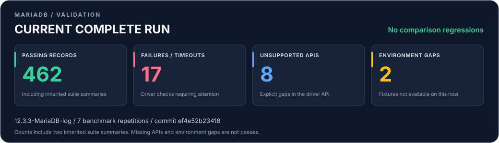

# Live MariaDB validation results

Current measured source, compared with the original unchanged-driver baseline. Uncommitted review builds are identified by input fingerprints below.

[Correctness](#correctness) · [Benchmarks](#benchmarks) · [Run details](#run-details) · [Raw results](results/current.json) · [Original baseline](baselines/macos-arm64-mariadb-12.3.3/SUMMARY.md)

## Implementation acceptance

Stage 1 targeted failures now passing: **23 / 23**. Original-baseline and last-accepted correctness protection: **PASS**.

Timing investigations above 5%: **9**; allocation investigations above 5%: **0**. These are investigation signals, not automatically accepted costs.

The frozen baseline retains its original meaning in all comparison tables. The last-accepted reference separately prevents an improvement being lost. [Acceptance evidence](results/stage1-gates.json) · [Confirmation history](results/stage1-confirmation.json) · [Supplementary evidence](results/references/stage1-after-final.json) · [Review notes](../docs/STAGE1_IMPLEMENTATION_NOTES.md).

Confirmation and supplementary files identify their own input fingerprints. Evidence with a different fingerprint is historical and does not confirm the current source.

Stage 3 prepared/native targets passing: **5 / 5**. [Roadmap and continuation](../docs/ROADMAP.md) · [Stage 3 implementation and validation](../docs/STAGE3_IMPLEMENTATION.md).

Stage 2 native-connection targets passing: **14 / 14**. Every PASS from the previous published stage is separately protected. [Stage 2 implementation and validation](../docs/STAGE2_IMPLEMENTATION.md).

> [!WARNING]
> **Performance acceptance remains open.** Timing/allocation signals require investigation across the entire confirmation window; they have not been waived or accepted automatically.

> [!CAUTION]
> **17 failed or timed-out check records remain.** Missing APIs and environment gaps are tracked separately; they are not passing tests.

**Baseline comparison: 🟢 No new regression signals** · 0 regression signals · 42 newly passing checks.

A passing comparison does not mean all functionality passes.

🟢 Newly passing checks

- `protocol.continuation-sequence-rejected`
- `protocol.large-row-is-not-eof`
- `protocol.unsigned-last-insert-id`
- `protocol.column-definition-roundtrip`
- `protocol.binary-plugin-challenge`
- `protocol.unknown-plugin-rejected`
- `protocol.native-extension-handshake`
- `protocol.prepared-out-capability`
- `protocol.empty-packet-predicate`
- `protocol.text-field-trailing-data`
- `protocol.text-field-integer-overflow`
- `protocol.reset-does-not-consume-pending-row`
- `connection.default-full-unicode`
- `auth.ed25519.tcp`
- `auth.ed25519.tls`
- `auth.ed25519.socket`
- `auth.parsec.tcp`
- `auth.parsec.tls`
- `auth.parsec.socket`
- `auth.sha2.tcp`
- `auth.sha2.socket`
- `sql.procedure-prepared-out`
- `sql.zero-date-preservation`
- `sql.unsigned-generated-id`
- `parameters.literal-question-mark`
- `parameters.comment-question-mark`
- `parameters.no-backslash-text`
- `packets.live-blob-16777216`
- `packets.live-blob-16777217`
- `packets.live-blob-33554430`
- `transaction.partial-result-exception`
- `transaction.nested-preserves-outer`
- `reliability.reset-unread-result`
- `reliability.server-kill-query`
- `reliability.tls-cancellation-propagates`
- `connection.localhost-address-fallback`
- `types.non-utf8-results`
- `capability.binary-bulk`
- `capability.metadata-cache`
- `capability.extended-metadata`
- `auth.mutual-tls-helper-client`
- `connection.mozilla-ca-store-installed`

| Reference | Commit |
| --- | --- |
| **Baseline** · original unchanged-driver run | `5deb205d5835` |
| **Current** · latest completed run | `ef4e52b23418` |

Both comparison tables use these same two runs.

## Correctness

Counts include two aggregate records for the inherited unit/property and integration suites; see [coverage](COVERAGE.md). Change = Current − Baseline, in check records.

| Status | Baseline | Current | Change vs baseline |
| --- | ---: | ---: | ---: |
| 🟢 PASS | 246 | **462** | 🟢 +216 |
| 🔴 FAIL | 56 | **17** | 🟢 -39 |
| 🟠 TIMEOUT | 0 | **0** | 0 |
| 🔵 UNSUPPORTED | 11 | **8** | -3 |
| 🟡 ENVIRONMENT_UNAVAILABLE | 2 | **2** | 0 |

🔴 Failed or timed-out checks (17) — expand all findings

| Test | Current status | Detail |
| --- | --- | --- |
| `reliability.timeout-before-metadata` | 🔴 FAIL | ConnectionUnavailable Broken |
| `cdc.multiple-table-maps` | 🔴 FAIL | user error (both mapped row events: expected 2, got 0) |
| `cdc.repeated-row-events` | 🔴 FAIL | user error (map reused for both row events: expected 2, got 1) |
| `cdc.table-id-mismatch` | 🔴 FAIL | user error (row matched correct table ID: expected 1, got 2) |
| `cdc.crc32-corruption-rejected` | 🔴 FAIL | user error (operation unexpectedly succeeded) |
| `cdc.native-event-160` | 🔴 FAIL | user error (partial event decoder: toEnum{BinLogEventType}: tag (160) is outside of enumeration's range (0,35) |
| `cdc.native-event-161` | 🔴 FAIL | user error (partial event decoder: toEnum{BinLogEventType}: tag (161) is outside of enumeration's range (0,35) |
| `cdc.native-event-162` | 🔴 FAIL | user error (partial event decoder: toEnum{BinLogEventType}: tag (162) is outside of enumeration's range (0,35) |
| `cdc.native-event-163` | 🔴 FAIL | user error (partial event decoder: toEnum{BinLogEventType}: tag (163) is outside of enumeration's range (0,35) |
| `cdc.native-event-164` | 🔴 FAIL | user error (partial event decoder: toEnum{BinLogEventType}: tag (164) is outside of enumeration's range (0,35) |
| `cdc.native-event-165` | 🔴 FAIL | user error (partial event decoder: toEnum{BinLogEventType}: tag (165) is outside of enumeration's range (0,35) |
| `cdc.native-event-166` | 🔴 FAIL | user error (partial event decoder: toEnum{BinLogEventType}: tag (166) is outside of enumeration's range (0,35) |
| `cdc.native-event-167` | 🔴 FAIL | user error (partial event decoder: toEnum{BinLogEventType}: tag (167) is outside of enumeration's range (0,35) |
| `cdc.native-event-168` | 🔴 FAIL | user error (partial event decoder: toEnum{BinLogEventType}: tag (168) is outside of enumeration's range (0,35) |
| `cdc.native-event-169` | 🔴 FAIL | user error (partial event decoder: toEnum{BinLogEventType}: tag (169) is outside of enumeration's range (0,35) |
| `cdc.native-event-170` | 🔴 FAIL | user error (partial event decoder: toEnum{BinLogEventType}: tag (170) is outside of enumeration's range (0,35) |
| `cdc.native-event-171` | 🔴 FAIL | user error (partial event decoder: toEnum{BinLogEventType}: tag (171) is outside of enumeration's range (0,35) |

🔵 Missing driver APIs (8) — expand all findings

| Test | Current status | Detail |
| --- | --- | --- |
| `capability.session-tracking` | 🔵 UNSUPPORTED | OK/session-state payloads are not exposed |
| `capability.reset-connection` | 🔵 UNSUPPORTED | no COM_RESET_CONNECTION API |
| `capability.progress-reporting` | 🔵 UNSUPPORTED | no negotiated MariaDB progress callback |
| `capability.cursor-fetch` | 🔵 UNSUPPORTED | no COM_STMT_FETCH/cursor API |
| `capability.long-data` | 🔵 UNSUPPORTED | no COM_STMT_SEND_LONG_DATA API |
| `capability.compression` | 🔵 UNSUPPORTED | no compressed packet transport |
| `cdc.gtid-resume` | 🔵 UNSUPPORTED | BinLogTracker only exposes filename/32-bit position; MariaDB GTID resume is absent |
| `cdc.durable-ack-control` | 🔵 UNSUPPORTED | semisync acknowledgements happen in the reader, before a consumer durability checkpoint |

🟡 Unavailable environment fixtures (2) — expand all findings

| Test | Current status | Detail |
| --- | --- | --- |
| `auth.pam-environment` | 🟡 ENVIRONMENT_UNAVAILABLE | PAM helper from the Homebrew bottle could not acquire root ownership; no OS PAM login fixture is configured |
| `auth.gssapi-environment` | 🟡 ENVIRONMENT_UNAVAILABLE | no Kerberos realm, keytab or GSSAPI login fixture configured on this Mac |

## Benchmarks

**Lower time is faster.** Both timing columns show median **ns/unit**; p95 describes complete operations in the Current run. [Coverage](COVERAGE.md) defines each workload's unit.

**Change = 100 × (Current − Baseline) / Baseline**, using unrounded medians. 🟢 Negative = faster · 🟡 Positive = slower · 🔴 More than 20% slower = investigate. ⚪ Zero at displayed precision = unchanged.

> [!NOTE]
> A benchmark marked PASS completed its workload. Its timing can still trigger a slowdown alert.

> [!NOTE]
> Native bulk execution and metadata caching are implemented. The two original native benchmark inventory slots remain frozen historical placeholders; current feature measurements and same-build comparisons are recorded in the [Stage 3 evidence](../docs/STAGE3_IMPLEMENTATION.md).

Environment, compiler, dependencies and benchmark workloads match the original baseline.

### Native MariaDB features

Same-build alternatives below use identical data, transactions and checksums. These new feature comparisons are separate from the original frozen baseline. Lower time/allocation is better; changes are `(current / baseline - 1) × 100`.

| Comparison | Baseline ns/unit | Current ns/unit | Change vs baseline | Allocation change |
| --- | ---: | ---: | ---: | ---: |
| `native_vs_sequential` | 39,690.2 | 1,786.0 | -95.5% | -91.1% |
| `native_vs_text_batch` | 9,704.2 | 1,786.0 | -81.6% | -77.7% |
| `unit_vs_aggregate` | 1,786.0 | 1,998.4 | +11.9% | +49.1% |
| `cached_vs_uncached_narrow` | 37,636.0 | 36,506.0 | -3.0% | -15.7% |
| `cached_vs_uncached_wide` | 69,636.0 | 53,460.0 | -23.2% | -73.5% |

Native timing units are rows for bulk inserts and complete queries for cached/uncached reads. Seven or more independent processes per profile each perform two warm-ups; all samples, CPU/GC counters and checksums are embedded in [current.json](results/current.json).

Native feature baseline comparison: **comparable**; timing investigations above 5%: **0**; allocation investigations: **0**. [Immutable native baseline](baselines/macos-arm64-native-statements/results.json).

### Haskell driver

| Workload | Baseline (ns/unit) | Current (ns/unit) | Change vs baseline | Current p95 (ms) | Current status |
| --- | ---: | ---: | --- | ---: | --- |
| `blob.prepared` | 3.1 | **3.1** | 🟢 -0.4% faster | 4.158 | 🟢 PASS |
| `blob.text` | 3.2 | **3.2** | 🟢 -1.1% faster | 4.598 | 🟢 PASS |
| `latency.prepared` | 41826.0 | **37760.0** | 🟢 -9.7% faster | 0.078 | 🟢 PASS |
| `latency.text` | 39354.0 | **41318.0** | 🟡 +5.0% slower | 0.075 | 🟢 PASS |
| `micro.binary-row` | 246.1 | **239.5** | 🟢 -2.7% faster | 24.082 | 🟢 PASS |
| `micro.text-row` | 313.2 | **290.6** | 🟢 -7.2% faster | 29.531 | 🟢 PASS |
| `native.bulk` | — | — | — | — | 🔵 UNSUPPORTED |
| `native.metadata-cache` | — | — | — | — | 🔵 UNSUPPORTED |
| `read.parallel-16` | 107.6 | **98.9** | 🟢 -8.1% faster | 18.417 | 🟢 PASS |
| `read.parallel-4` | 118.0 | **138.2** | 🟡 +17.1% slower | 6.767 | 🟢 PASS |
| `read.prepared.narrow` | 314.6 | **290.4** | 🟢 -7.7% faster | 4.076 | 🟢 PASS |
| `read.prepared.wide` | 2425.1 | **2316.6** | 🟢 -4.5% faster | 24.556 | 🟢 PASS |
| `read.socket.narrow` | 339.2 | **339.0** | 🟢 -0.1% faster | 3.750 | 🟢 PASS |
| `read.text.narrow` | 305.5 | **322.1** | 🟡 +5.4% slower | 3.549 | 🟢 PASS |
| `read.text.wide` | 2876.4 | **2696.9** | 🟢 -6.2% faster | 28.026 | 🟢 PASS |
| `read.tls.narrow` | 370.6 | **396.9** | 🟡 +7.1% slower | 5.721 | 🟢 PASS |
| `read.vector.narrow` | 365.8 | **350.2** | 🟢 -4.3% faster | 4.160 | 🟢 PASS |
| `write.execute-many` | 9670.0 | **7881.0** | 🟢 -18.5% faster | 8.492 | 🟢 PASS |
| `write.prepared` | 39408.0 | **38343.0** | 🟢 -2.7% faster | 38.934 | 🟢 PASS |
| `write.text` | 38324.0 | **41570.0** | 🟡 +8.5% slower | 42.030 | 🟢 PASS |

### MariaDB Connector/C control

| Workload | Baseline (ns/unit) | Current (ns/unit) | Change vs baseline | Current p95 (ms) | Current status |
| --- | ---: | ---: | --- | ---: | --- |
| `blob.text` | 3.0 | **3.2** | 🟡 +3.7% slower | 4.336 | 🟢 PASS |
| `latency.text` | 26568.0 | **25704.0** | 🟢 -3.3% faster | 0.066 | 🟢 PASS |
| `read.text.narrow` | 197.4 | **208.9** | 🟡 +5.8% slower | 2.183 | 🟢 PASS |
| `read.text.wide` | 1261.0 | **1159.2** | 🟢 -8.1% faster | 14.322 | 🟢 PASS |
| `write.execute-many` | 7635.0 | **7710.0** | 🟡 +1.0% slower | 8.015 | 🟢 PASS |
| `write.text` | 28478.0 | **27495.0** | 🟢 -3.5% faster | 31.779 | 🟢 PASS |

— means no successful measurement is available, or the runs cannot be compared for Change.

Each measured process has two warm-ups; this run has **7 repetitions** per profile. All samples, allocations, GC statistics, checksums and latency measurements are retained in [current.json](results/current.json).

## Run details

Revision, environment and reproducibility

| Field | Latest attempt |
| --- | --- |
| State / exit code | COMPLETED / 0 |
| Parent commit (working-tree inputs are identified separately) | [`ef4e52b234187435d1ea464834df629cea5f267a`](https://github.com/aantich/mariadb-haskell/commit/ef4e52b234187435d1ea464834df629cea5f267a) |
| Branch | `main` |
| Started / finished (UTC) | 2026-11-07T15:54:03.932104+00:00 / 2026-11-07T15:54:54.591064+00:00 |
| Input fingerprint | `9987450d8d8b8e21ac33e3382edc17dd4186aded7abfb10e23ffe5c9e8f5a6d5` |
| Local logs and build plan | `validation/results/runs/stage3-publication-1` (ignored by Git) |
| Server of completed run | 12.3.3-MariaDB-log |
| Host | Apple M4 Max; macOS 26.4 |
| Compiler / build tool | GHC 9.10.3; Cabal 3.16.1.0 |
| MariaDB Connector/C | 3.4.10 |
| Complete suite / repetitions | True / 7 |
| Driver/workloads stable during execution | True |

Committed runs identify their tested revision. An uncommitted review run identifies its parent revision plus SHA-256 hashes of the actual working-tree inputs; it does not claim the parent commit contains these changes. A following results-only commit does not claim another test run. CI checks that the report, graphic and raw results match the current inputs.

Full `python3 validation/check.py` runs refresh this live document, [overview.svg](results/overview.svg) and [current.json](results/current.json), including failed attempts. Commit all three with each tested change. Git history retains previous results.

